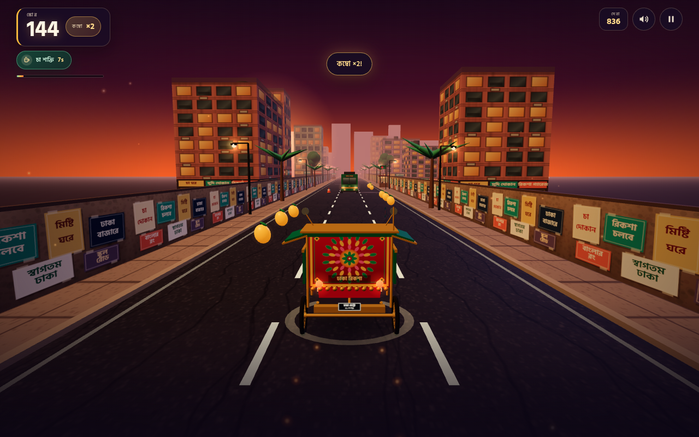

# রিকশা রাশ · Dhaka Rickshaw Rush

A 3D endless-runner game set on a golden-hour street in Dhaka, Bangladesh.

Ride a hand-painted cycle rickshaw through traffic, dodge BRTC buses, CNGs, cows and
roadside cones, and collect mangoes to build a combo. Grab a clay cup of **cha** for a
one-hit shield. The street gets faster the further you ride.

Everything — the rickshaw, buildings, poster wall, bus livery, sky and sound — is
generated in code. No downloaded art or audio.



## Play

```bash
python3 -m http.server 3002
# open http://localhost:3002
```

The game is a static site: `index.html`, `styles.css` and ES modules in `src/`.
Three.js r160 and the Hind Siliguri font are vendored under `vendor/`, so it also
runs offline.

## Controls

| Action | Keyboard | Touch |
| --- | --- | --- |
| Change lane | `←` `→` / `A` `D` | swipe left/right or use the arrow buttons |
| Jump | `↑` / `W` / `Space` | swipe up or press **লাফ** |
| Pause | `P` / `Esc` | pause button |
| Mute | `M` | speaker button |

- Mangoes add `15 × multiplier` points. Every third mango raises the combo, up to ×5.
- **চা শক্তি** (cha power) absorbs one crash for nine seconds.
- Best score is stored in `localStorage`.
- The layout is tuned for phones in both portrait and landscape, with safe-area
  padding and no browser gesture conflicts. Auto-pauses when the tab is hidden.

## Tech notes

- **Rendering:** Three.js r160, WebGL, ACES tone mapping, procedural sky shader,
  canvas-generated textures, fog, pooled scenery and traffic.
- **Game feel:** chase camera with speed FOV, lane lean, jump physics, screen shake,
  particle bursts, fake contact shadows and a scrolling road.
- **Audio:** WebAudio synthesis for the bell, crash, wind, mango chime and cha
  arpeggio. No audio files.
- **UI:** Bengali-first HUD and menus with local Hind Siliguri webfonts.

## Credits

- [Three.js](https://threejs.org) — MIT, see `vendor/THREE-LICENSE.txt`.
- [Hind Siliguri](https://fonts.google.com/specimen/Hind+Siliguri) by Indian Type
  Foundry — SIL Open Font License 1.1, see `vendor/fonts/OFL.txt`.
- Game, art and sound generated for this project.

<!-- omgithub:readme:start -->
## 🚀 Build, play, and remix with OMGithub

**Created using [OMGithub.com](https://omgithub.com).**

[](https://omgithub.com/mdraijun26-tech/PlayGround)
[](https://github.com/mdraijun26-tech/PlayGround)

- 🎮 [Open the project](https://omgithub.com/mdraijun26-tech/PlayGround).
- ✨ [Remix this project](https://omgithub.com/?remix=mdraijun26-tech%2FPlayGround).
- 💻 [Explore the source](https://github.com/mdraijun26-tech/PlayGround).
- 🛠️ [Check build runs](https://github.com/mdraijun26-tech/PlayGround/actions).
- 🐛 [Report an issue](https://github.com/mdraijun26-tech/PlayGround/issues).
- 👤 [Explore the creator's projects](https://omgithub.com/mdraijun26-tech).
- 🌍 [Create with OMGithub](https://omgithub.com).
<!-- omgithub:readme:end -->
